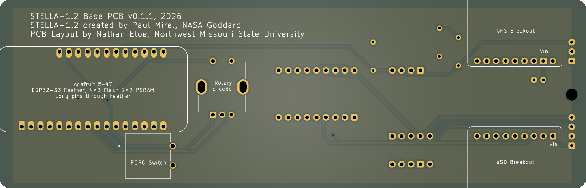
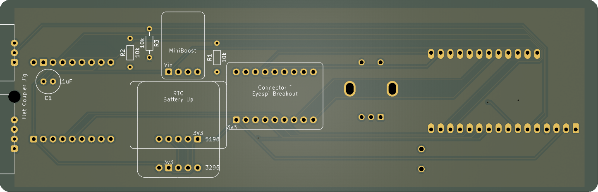
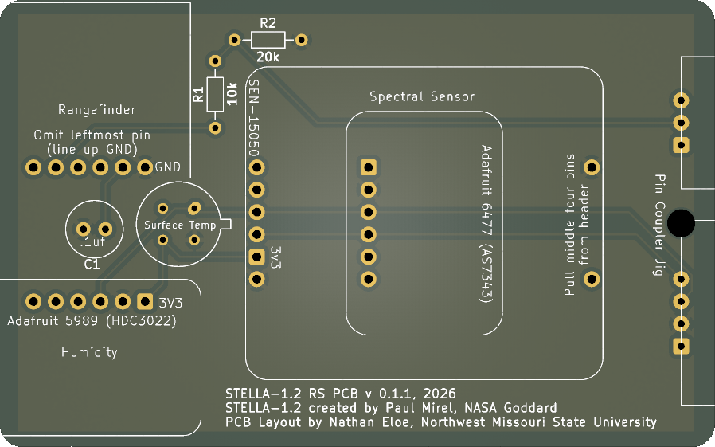

# STELLA 1.2 Permaproto Replacement PCBs

These boards are designed to be drop in replacement for the full and half permaprotos used in the [NASA STELLA 1.2](https://science.gsfc.nasa.gov/stella/) project.
Not all modules are supported at this time.
STELLA-1.2 was created by Paul Mirel, NASA Goddard.

These KiCad projects were designed in KiCad 10; if the place you are having your boards fabricated do not support kicad_pcb files, you should generate the Gerber files with the options required by your fabricator, though some "generic" gerber/drl files will be provided in releases (coming soon).

## Assembly Instruction

You will require the same BOM as the full project, with the exception of the permaproto boards and wire.
The boards try to be as self documenting as possible with the silk screens.
On the base board the build instructions have you placing components on both sides of the board.
The correct orientation and side is indicated with the silkscreens; a component's outline appears on the side of the board on which it should be placed; see the renderings below for an example.

Some boards have multiple footprints for the same component.
This includes (but may not be limited to in the future):

* Base PCB RTC Module
    * Both listed Adafruit SKUs use the same RTC chip but have different sizes; use whichever you are able to get in stock
* RS Spectral Sensor
    * The Triad sensor is EOL, though new stock may crop up from time to time
    * The replacement Adafruit spectral sensor should line up with the 3D printed case slot for the triad
* RS Temperature/Humidity
    * Due to parts availability, the HDC3022 module can be swapped for the SHT4x series; use the appropriate set of pins for whichever sensor is available

## Board Renderings

### Base PCB

### Remote Sensing module (RS)

